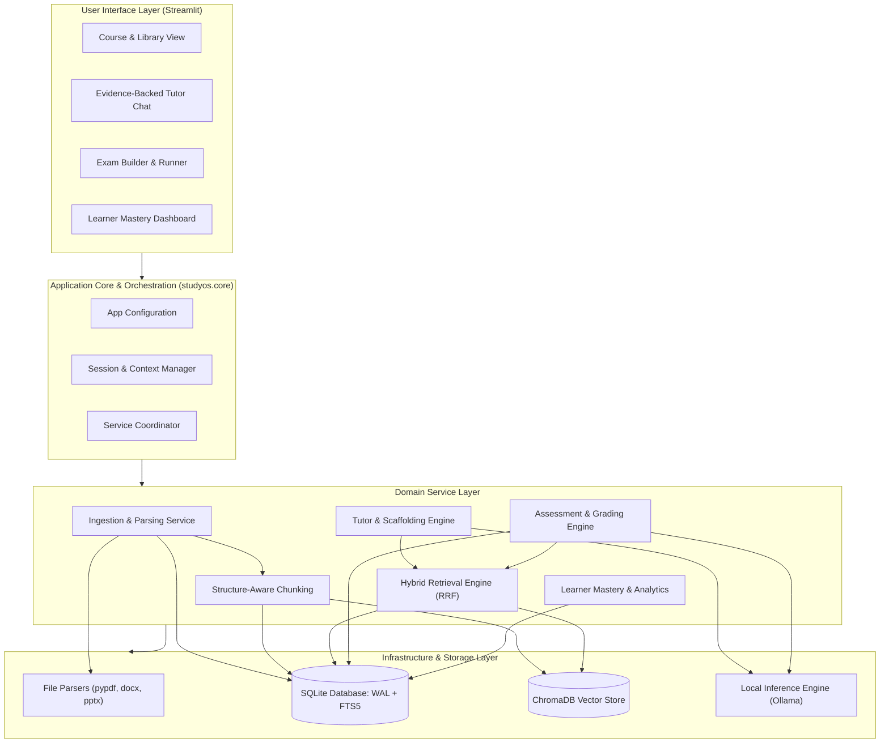
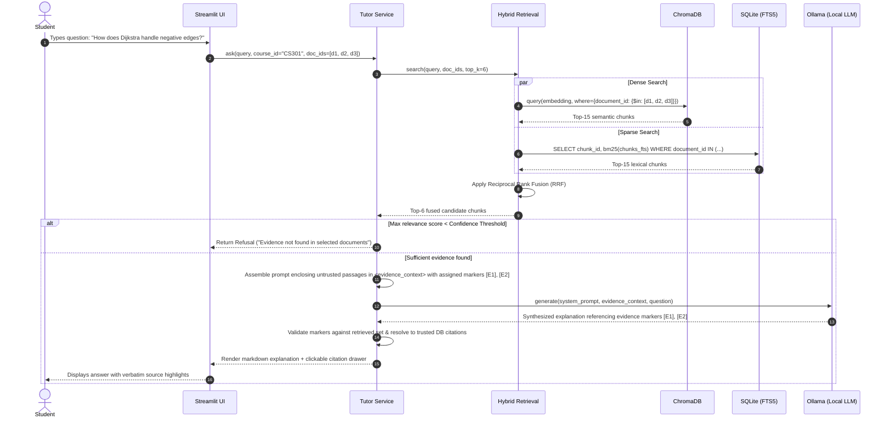
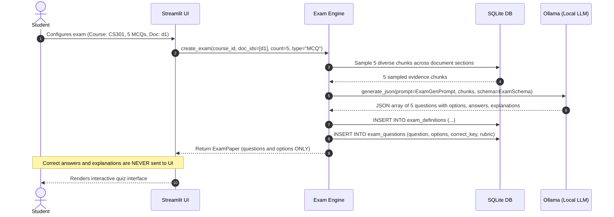
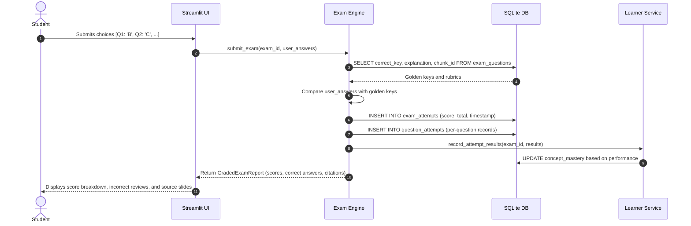
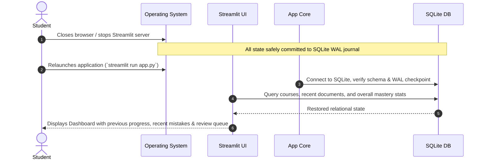

# StudyOS — System Architecture & Technical Design Baseline

- **Document Version:** 1.0.0
- **Status:** Draft Architecture Baseline Awaiting Final Review (Stage 0)
- **System Target:** Local-First Personalized Learning Operating System
- **Hardware Profile:** Windows 11 | NVIDIA RTX 5060 Laptop GPU (8 GB VRAM) | 16 GB System RAM

---

## 1. Architectural Philosophy & Core Principles

StudyOS is engineered under four strict architectural tenets:
1. **Separation of Cognitive Logic and Deterministic State:** The Language Model is treated as a stateless reasoning and synthesis engine. State, session history, course hierarchies, exam configurations, grading records, and mastery statistics are owned and enforced deterministically by SQLite. The LLM is never the database.
2. **Strict Evidence Provenance:** No answer, explanation, or quiz question exists in isolation. Every piece of AI-generated content carries structured metadata pointing to the specific document ID, filename, page/slide number, and text chunk ID from which it was derived.
3. **Hardware-Symbiotic Resource Management:** The system is explicitly designed for a consumer workstation (RTX 5060 8GB VRAM / 16GB RAM). Heavy dependencies, unbounded context windows, and concurrent model loading are eliminated in favor of sequential execution, quantized inference (4-bit), and lightweight embeddings.
4. **Zero-Framework Vendor Neutrality:** The codebase avoids heavyweight or opaque "agentic wrapper" frameworks (e.g., LangChain, CrewAI, AutoGen). All pipelines use standard, readable, type-annotated Python, decoupled via protocol interfaces.

---

## 2. Planned High-Level System Architecture (Design Phase)

StudyOS follows a layered Clean / Hexagonal Architecture:



---

## 3. Modular Breakdown & Component Boundaries

### 3.1 User Interface Layer (`studyos.ui`)
- **Responsibilities:** Renders the interactive frontend in Streamlit; captures user inputs (document uploads, course selection, chat prompts, exam answers); displays evidence citations and mastery visualizations.
- **Inputs:** User events, uploaded binary files, form submissions.
- **Outputs:** Visual widgets, chat history, markdown with inline citation pills, quiz results.
- **Dependencies:** `studyos.core`, `studyos.services`.
- **Constraint:** Pure presentation. The UI must never directly query ChromaDB, raw parser libraries, or make raw HTTP calls to inference endpoints.

### 3.2 Application Core & Orchestration (`studyos.core`)
- **Responsibilities:** Manages global configuration, paths, logging setup, hardware environment checks, and database connection pooling.
- **Inputs:** Environment variables, `config.yaml`, system signals.
- **Outputs:** Initialized service instances, structured logging handlers.
- **Dependencies:** Standard library, `pydantic`.

### 3.3 Document Ingestion & Parsers (`studyos.ingestion`)
- **Responsibilities:** Ingests raw files, calculates SHA-256 hashes to prevent duplicate ingestion, validates document integrity, and delegates to format-specific extractors.
- **Subcomponents:**
  - `PDFParser`: Uses `pypdf` (or `pymupdf` fallback) to extract digital text, retaining 1-indexed page numbers.
  - `DOCXParser`: Uses `python-docx` to extract paragraphs, tables, and heading levels.
  - `PPTXParser`: Uses `python-pptx` to extract slide numbers, slide titles, shapes, and presenter notes.
  - `TXTParser`: Reads clean UTF-8 text with structured boundary normalization.
- **Inputs:** File paths or uploaded binary buffers, `course_id`.
- **Outputs:** Standardized `ParsedDocument` containing metadata, document hash, and list of `PageElement` objects with location markers.
- **Dependencies:** `pypdf`, `python-docx`, `python-pptx`.

### 3.4 Text Normalization & Chunking (`studyos.chunking`)
- **Responsibilities:** Transforms variable-length document elements into uniform, semantically cohesive chunks suitable for vector embedding and lexical search.
- **Logic:**
  - Bounded size: 300–600 tokens (approx. 1,200–2,400 characters).
  - Overlap: 50–100 tokens, maintaining sentence integrity.
  - Header injection: Every chunk begins with a breadcrumb header: `[Source: <filename> | Slide/Page: <location> | Section: <heading>]`.
- **Inputs:** `ParsedDocument`.
- **Outputs:** List of `DocumentChunk` entities, each with unique `chunk_id`, `document_id`, `chunk_index`, `content`, `content_hash`, and `metadata_json`.
- **Dependencies:** Standard library regex, `tiktoken` or character-boundary tokenizers.

### 3.5 Embedding & Vector Storage (`studyos.retrieval.vector`)
- **Responsibilities:** Generates dense numerical representations of chunks and indexes them for approximate nearest neighbor (ANN) search.
- **Embedding Protocol (`EmbeddingProvider`):** Abstract base class supporting local embeddings. Default implementation delegates to Ollama's `all-minilm` or a lightweight local ONNX runner (`fastembed` / `bge-small-en-v1.5`).
- **Vector Store:** ChromaDB running in persistent local directory mode (`chromadb.PersistentClient`).
- **Collection Strategy:** Single unified collection with metadata filtering on `course_id` and `document_id`, avoiding the overhead of thousands of separate ChromaDB collections.
- **Inputs:** Text strings, metadata dictionaries.
- **Outputs:** 384-dimensional dense vectors, similarity search result sets.
- **Dependencies:** `chromadb`, local embedding provider.

### 3.6 Keyword & Hybrid Retrieval (`studyos.retrieval.hybrid`)
- **Responsibilities:** Delivers high-precision retrieval by merging dense semantic similarity (ChromaDB) with exact keyword matching (SQLite FTS5 BM25).
- **Algorithm (Reciprocal Rank Fusion - RRF):**
  $$RRF\_Score(d) = \sum_{m \in \{dense, sparse\}} \frac{1}{k + rank_m(d)}$$
  where $k = 60$. RRF eliminates the need to normalize raw cosine similarities against unbounded BM25 scores.
- **Inputs:** Search query string, `course_id`, list of selected `document_id`s, `top_k`.
- **Outputs:** Ranked list of `RetrievedChunk` objects with fused scores and original citation metadata.
- **Dependencies:** `ChromaStore`, `SQLiteDB`.

### 3.7 Local Model Inference (`studyos.inference`)
- **Responsibilities:** Wraps local LLM execution behind a swappable interface.
- **Protocol (`LLMProvider`):**
  ```python
  class LLMProvider(Protocol):
      def generate(self, prompt: str, system_prompt: str, **kwargs) -> str: ...
      def generate_json(self, prompt: str, system_prompt: str, schema: dict) -> dict: ...
  ```
- **Default Provider:** `OllamaProvider` connecting via local HTTP (`http://127.0.0.1:11434/api`).
- **Features:** Strict JSON mode enforcement using formal schemas for quiz generation and grading rubrics; temperature control (0.0 for grading/facts, 0.4 for tutoring); context length caps (e.g., 4,096 tokens).
- **Dependencies:** `httpx` or `ollama-python`.

### 3.8 Evidence-Backed Tutoring Service (`studyos.tutoring`)
- **Responsibilities:** Orchestrates the retrieval-augmented generation (RAG) loop for student Q&A, conceptual synthesis, and Socratic scaffolding.
- **Grounding Guardrail:** If max retrieved chunk relevance score is below threshold $\tau$, the service bypasses the LLM and outputs a standardized refusal: *"The selected course documents do not contain sufficient evidence to answer this question."*
- **Inputs:** Student question, active `course_id`, selected `document_id` set, conversation history (bounded to last 3 turns).
- **Outputs:** Grounded answer markdown, list of structured citation links (`document_name`, `page_slide`, `verbatim_chunk`).
- **Dependencies:** `RetrievalService`, `LLMProvider`.

### 3.9 Assessment & Exam Engine (`studyos.assessment`)
- **Responsibilities:** Generates multi-choice and short-answer quizzes grounded strictly in selected documents; securely stores answer keys; evaluates submitted answers.
- **Two-Phase Generation Flow:**
  1. *Generation Phase:* Selects representative chunks across target documents $\rightarrow$ Prompts LLM in JSON mode to construct questions, distractors, correct answers, and rubrics $\rightarrow$ Stores in SQLite $\rightarrow$ Returns *only* question prompts and options to frontend.
  2. *Grading Phase:* Receives submitted choices/text $\rightarrow$ Scores MCQs deterministically $\rightarrow$ Evaluates short-answer responses via LLM rubric comparison $\rightarrow$ Commits results to SQLite learner history $\rightarrow$ Emits explanations and citations.
- **Inputs:** `course_id`, target `document_id`s, question count, difficulty level.
- **Outputs:** `ExamPaper` (pre-submission), `GradedExamReport` (post-submission).
- **Dependencies:** `RetrievalService`, `LLMProvider`, `SQLiteDB`.

### 3.10 Persistent Learner Model & Analytics (`studyos.learner`)
- **Responsibilities:** Maintains the student's mastery profile across courses and topics; logs errors; identifies recurring misconceptions.
- **Mastery Calculation:** Exponential moving average or Bayesian Knowledge Tracing updating topic competency $M \in [0.0, 1.0]$:
  $$M_{new} = M_{old} + \alpha \cdot (Score - M_{old})$$
  Penalizes repeated errors on foundational questions; provides uncertainty intervals based on sample size.
- **Inputs:** `question_attempts` records.
- **Outputs:** Topic mastery scores, list of flagged weaknesses, candidate questions for remediation exams.
- **Dependencies:** `SQLiteDB`.

### 3.11 Logging, Testing & Evaluation (`studyos.eval`)
- **Responsibilities:** Structured logging with privacy scrubbing (masks raw document snippets from terminal output); automated regression test runners; retrieval precision and answer faithfulness benchmarks.
- **Dependencies:** `pytest`, standard logging.

---

## 4. End-to-End Data Flows

### Scenario 1: User Uploads a New PDF Document
```mermaid
sequenceDiagram
    autonumber
    actor Student
    participant UI as Streamlit UI
    participant Ingest as Ingestion Service
    participant Parser as PDFParser
    participant Chunker as Structure Chunker
    participant VectorDB as ChromaDB
    participant RelDB as SQLite DB

    Student->>UI: Uploads "lecture_03.pdf" (Course: CS301)
    UI->>Ingest: ingest_file(file_bytes, filename, course_id)
    Ingest->>Ingest: Compute SHA-256 hash
    Ingest->>RelDB: Check if hash exists in documents
    alt Hash already exists
        RelDB-->>Ingest: Existing document_id found
        Ingest-->>UI: Return "File already ingested" warning
    else Unique document
        Ingest->>RelDB: INSERT INTO documents (status="processing")
        Ingest->>Parser: extract_pages(file_bytes)
        Parser-->>Ingest: List of PageElements (text + page_num)
        Ingest->>Chunker: chunk_document(pages, chunk_size=500, overlap=50)
        Chunker-->>Ingest: List of DocumentChunks (with header prefix)
        Ingest->>RelDB: INSERT INTO chunks (bulk insert; SQLite triggers automatically sync chunks_fts)
        Ingest->>VectorDB: add_embeddings(chunks, metadata)
        Ingest->>RelDB: UPDATE documents SET status="ready", chunk_count=N
        Ingest-->>UI: Return IngestionSuccess(chunk_count=N)
        UI-->>Student: Display "Document Ready" with summary stats
    end
```

### Scenario 2: User Asks a Question About Three Selected Documents


### Scenario 3: User Generates an Exam From Selected Documents


### Scenario 4: User Submits an Answer and Receives Feedback


### Scenario 5: User Closes Application and Later Resumes Studying


---

## 5. Traceability Architecture: Tracking Evidence from File to Answer

To ensure answers are verifiably grounded, an unbroken chain of custody connects raw files to rendered output without trusting arbitrary free-form LLM citations:

```
[Raw File: cs101_lec02.pptx]
      │ (SHA-256: sha256_placeholder_9f8e7d... — Illustrative placeholder, real 64-char hex computed on upload)
      ▼
[Database Record: documents]
      ├── id: "doc_a1b2c3d4"
      ├── course_id: "crs_algorithms"
      └── filename: "cs101_lec02.pptx"
            │
            ▼ (Parsing & Chunking)
      [Database Record: chunks & ChromaDB Vector]
            ├── id: "chk_9f8e7d6c"
            ├── document_id: "doc_a1b2c3d4"
            ├── chunk_index: 14
            ├── location: {"slide": 18, "title": "Bellman-Ford Relaxations"}
            ├── content: "[Source: cs101_lec02.pptx | Slide 18] Algorithm loops |V|-1 times..."
            └── content_hash: "7f4d2a1b"
                  │
                  ▼ (Hybrid Retrieval RRF)
            [Retrieved Evidence Object in Python Memory]
                  ├── chunk_id: "chk_9f8e7d6c"
                  ├── evidence_id: "[E1]" (Application-assigned temporary reference marker)
                  ├── citation_label: "[cs101_lec02.pptx, Slide 18]"
                  └── text: "Algorithm loops |V|-1 times..."
                        │
                        ▼ (Evidence Context Assembly)
                  [LLM Synthesis Context (Untrusted Passages Delimited)]
                        ├── Prompt instructs: "Rely only on enclosed <evidence_context>. Cite facts using [E1], [E2]. Do not cite outside IDs."
                        └── LLM generates: "Bellman-Ford handles negative weights [E1]."
                              │
                              ▼ (Evidence ID Validation & Resolution)
                        [Application Citation Resolver]
                              ├── Validates: [E1] ∈ retrieved_evidence_set
                              ├── Resolves: [E1] -> Database metadata (cs101_lec02.pptx, Slide 18)
                              └── UI renders clickable badge: "[cs101_lec02.pptx: Slide 18]" (opens verbatim text of "chk_9f8e7d6c")
```

### 5.1 Evidence ID Provenance & Injection Defense Lifecycle

To prevent hallucinated citations and guard against prompt injection via malicious document text, StudyOS implements a strict 7-step provenance lifecycle:
1. **Application-Assigned Evidence Markers:** For each retrieved chunk, the application generates a temporary, session-scoped evidence marker (`[E1]`, `[E2]`, etc.) associated with the immutable backend records (`chunk_id`, `document_id`, source location, and text).
2. **Untrusted Passage Delimitation & Defense in Depth:** Raw document text is treated as untrusted data. Passages are injected inside explicit XML delimiters (e.g., `<evidence_context><passage id="E1">...</passage></evidence_context>`) to separate source text from instructions. Because delimiters alone do not provide a complete security guarantee against prompt injection, this is reinforced by: (a) system instructions declaring document text strictly non-authoritative, (b) application-side token extraction that ignores free-form citations, and (c) strict backend validation requiring all markers to resolve against application-owned chunk records.
3. **Restricted Citation Instruction:** The model prompt mandates: *"Base your answers only on the enclosed evidence. Cite statements using only the provided markers [E1], [E2]. Do not invent filenames, slide numbers, or citation IDs."*
4. **Output Token Extraction:** The application parses the generated text to extract all `[E\d+]` citation tokens.
5. **Set-Membership Validation:** Every extracted marker is validated against the active retrieved evidence set.
6. **Trusted Metadata Resolution:** Validated markers are resolved into display citations (`[Document Title, p. X / Slide Y]`) using trusted SQLite database records—never free-form model text.
7. **Rejection of Unknown Markers:** Any marker referencing an ID outside the retrieved set (or generated in a hallucinated format) is rejected. Missing or invalid citations are recorded as grounding failures, never silently converted into synthetic references.

---

## 6. Database Schema Direction (SQLite Relational Model)

SQLite is used with Write-Ahead Logging (`PRAGMA journal_mode=WAL;`), foreign keys enabled (`PRAGMA foreign_keys=ON;`), and UTF-8 encoding.

### 6.1 FTS5 Synchronization & Transaction Recovery Design
The full-text search table `chunks_fts` is configured as a regular contentful FTS5 virtual table. To prevent duplicate application-level writes and avoid index drift, SQLite database triggers serve as the **single synchronization owner**:
- **Insertions:** When new chunks are inserted into `chunks`, trigger `chunks_ai` automatically indexes their content into `chunks_fts`.
- **Deletions & Cascades:** When a course or document is deleted, SQLite foreign key cascades delete the corresponding `chunks` rows, which immediately fires trigger `chunks_ad` (`DELETE FROM chunks_fts WHERE chunk_id = old.id;`), ensuring no orphaned full-text entries remain.
- **Updates & Re-indexing:** Trigger `chunks_au` (`AFTER UPDATE OF content, document_id, course_id ON chunks`) deletes old entries and re-indexes updated content and metadata whenever chunk text, document attribution, or course assignment is modified.
- **Transaction Rollback & Crash Consistency:** Because triggers execute within the enclosing ingestion database transaction, any interrupted upload or database failure that triggers a `ROLLBACK` automatically rolls back both `chunks` rows and `chunks_fts` virtual entries simultaneously, guaranteeing zero partial or corrupted index states.

```sql
-- Courses Table
CREATE TABLE courses (
    id TEXT PRIMARY KEY,
    name TEXT NOT NULL,
    code TEXT UNIQUE,
    description TEXT,
    created_at TIMESTAMP DEFAULT CURRENT_TIMESTAMP,
    updated_at TIMESTAMP DEFAULT CURRENT_TIMESTAMP
);

-- Documents Table
CREATE TABLE documents (
    id TEXT PRIMARY KEY,
    course_id TEXT NOT NULL REFERENCES courses(id) ON DELETE CASCADE,
    filename TEXT NOT NULL,
    file_type TEXT NOT NULL, -- 'pdf', 'docx', 'pptx', 'txt'
    file_size_bytes INTEGER NOT NULL,
    sha256_hash TEXT NOT NULL,
    status TEXT NOT NULL, -- 'pending', 'processing', 'ready', 'failed'
    total_pages_or_slides INTEGER DEFAULT 0,
    chunk_count INTEGER DEFAULT 0,
    error_message TEXT,
    created_at TIMESTAMP DEFAULT CURRENT_TIMESTAMP,
    UNIQUE(course_id, sha256_hash)
);

-- Chunks Table (Metadata & Raw Text)
CREATE TABLE chunks (
    id TEXT PRIMARY KEY,
    document_id TEXT NOT NULL REFERENCES documents(id) ON DELETE CASCADE,
    course_id TEXT NOT NULL REFERENCES courses(id) ON DELETE CASCADE,
    chunk_index INTEGER NOT NULL,
    location_type TEXT NOT NULL, -- 'page', 'slide', 'section'
    location_index INTEGER NOT NULL, -- e.g. Page 12 or Slide 5
    location_title TEXT, -- e.g. Slide Title or Heading
    content TEXT NOT NULL,
    token_count INTEGER NOT NULL,
    content_hash TEXT NOT NULL,
    created_at TIMESTAMP DEFAULT CURRENT_TIMESTAMP
);

-- Full-Text Search Virtual Table (FTS5) for BM25 Keyword Search (Contentful)
CREATE VIRTUAL TABLE chunks_fts USING fts5(
    content,
    chunk_id UNINDEXED,
    document_id UNINDEXED,
    course_id UNINDEXED,
    tokenize = 'porter unicode61'
);

-- FTS5 Synchronization Triggers (Single Synchronization Owner)
-- 1. Insert Trigger: automatically indexes new chunks into FTS5
CREATE TRIGGER chunks_ai AFTER INSERT ON chunks BEGIN
    INSERT INTO chunks_fts(content, chunk_id, document_id, course_id)
    VALUES (new.content, new.id, new.document_id, new.course_id);
END;

-- 2. Delete Trigger: automatically removes deleted chunks from FTS5 (including CASCADE deletes)
CREATE TRIGGER chunks_ad AFTER DELETE ON chunks BEGIN
    DELETE FROM chunks_fts WHERE chunk_id = old.id;
END;

-- 3. Update Trigger: automatically re-indexes updated chunks in FTS5
CREATE TRIGGER chunks_au AFTER UPDATE OF content, document_id, course_id ON chunks BEGIN
    DELETE FROM chunks_fts WHERE chunk_id = old.id;
    INSERT INTO chunks_fts(content, chunk_id, document_id, course_id)
    VALUES (new.content, new.id, new.document_id, new.course_id);
END;

-- Exam Definitions Table
CREATE TABLE exam_definitions (
    id TEXT PRIMARY KEY,
    course_id TEXT NOT NULL REFERENCES courses(id) ON DELETE CASCADE,
    title TEXT NOT NULL,
    difficulty TEXT NOT NULL, -- 'easy', 'medium', 'hard'
    question_count INTEGER NOT NULL,
    time_limit_minutes INTEGER,
    created_at TIMESTAMP DEFAULT CURRENT_TIMESTAMP
);

-- Exam Questions Table (Golden Answers Isolated)
CREATE TABLE exam_questions (
    id TEXT PRIMARY KEY,
    exam_id TEXT NOT NULL REFERENCES exam_definitions(id) ON DELETE CASCADE,
    chunk_id TEXT REFERENCES chunks(id) ON DELETE SET NULL,
    question_type TEXT NOT NULL, -- 'mcq', 'short_answer'
    question_text TEXT NOT NULL,
    options_json TEXT, -- JSON array of options for MCQ, NULL for short answer
    correct_answer TEXT NOT NULL, -- Isolated on backend until submission
    explanation TEXT NOT NULL,
    rubric_json TEXT, -- Criteria for short-answer grading
    question_order INTEGER NOT NULL
);

-- Exam Attempts Table (Overall Student Sessions)
CREATE TABLE exam_attempts (
    id TEXT PRIMARY KEY,
    exam_id TEXT NOT NULL REFERENCES exam_definitions(id) ON DELETE CASCADE,
    score_achieved REAL NOT NULL,
    score_max REAL NOT NULL,
    duration_seconds INTEGER,
    completed_at TIMESTAMP DEFAULT CURRENT_TIMESTAMP
);

-- Question Attempts Table (Granular Per-Question History & Mistake Logging)
CREATE TABLE question_attempts (
    id TEXT PRIMARY KEY,
    attempt_id TEXT NOT NULL REFERENCES exam_attempts(id) ON DELETE CASCADE,
    question_id TEXT NOT NULL REFERENCES exam_questions(id) ON DELETE CASCADE,
    user_answer TEXT NOT NULL,
    is_correct BOOLEAN NOT NULL,
    score_awarded REAL NOT NULL,
    feedback TEXT,
    attempted_at TIMESTAMP DEFAULT CURRENT_TIMESTAMP
);

-- Concept Mastery Table
CREATE TABLE concept_mastery (
    id TEXT PRIMARY KEY,
    course_id TEXT NOT NULL REFERENCES courses(id) ON DELETE CASCADE,
    topic_tag TEXT NOT NULL,
    mastery_score REAL NOT NULL DEFAULT 0.5, -- Range 0.0 (novice) to 1.0 (master)
    confidence_interval REAL NOT NULL DEFAULT 0.5,
    total_attempts INTEGER DEFAULT 0,
    successful_attempts INTEGER DEFAULT 0,
    last_tested_at TIMESTAMP,
    updated_at TIMESTAMP DEFAULT CURRENT_TIMESTAMP,
    UNIQUE(course_id, topic_tag)
);
```

---

## 7. Technical Decisions & Evaluation Matrix

| Domain | Selected Technology | Evaluated Alternatives | Technical Rationale & Trade-Offs |
| :--- | :--- | :--- | :--- |
| **Runtime & Tooling** | **Python 3.12 (via `uv`)** *(Host has 3.13 / 3.14 installed)* | Poetry, Conda, standard `pip` + `venv` | `uv` is installed (`v0.10.10`). Python 3.12 is the intended development target to ensure binary wheel compatibility for ChromaDB/native extensions; `uv` handles isolated environment provisioning seamlessly without system pollution. |
| **PDF Extraction** | **`pypdf`** (Primary) + **`pymupdf`** (Fallback) | `pdfminer.six`, `unstructured`, `tesseract` OCR | `pypdf` is lightweight, pure-Python, zero external C++ DLL dependencies on Windows, and fast for digital PDFs. `pymupdf` provides high-speed C-bindings if complex fonts emerge. Heavy OCR is deferred to keep base dependencies small. |
| **DOCX / PPTX Extraction** | **`python-docx`** & **`python-pptx`** | Pandoc, `libreoffice` headless | Native Python libraries extract slide titles, notes, and headings directly from OpenXML archives without external server binaries. |
| **Vector Storage** | **`ChromaDB` (Persistent Directory)** | FAISS, LanceDB, Qdrant | Runs completely in-process on the local filesystem. No separate background daemon required; built-in metadata filtering by `course_id` and `document_id`. |
| **Embedding Model** | **`all-minilm` (via Ollama or local ONNX)** | `text-embedding-3-small` (Cloud), `e5-mistral-7b` | `all-minilm` is cached in the user's Ollama manifest library, outputs 384-dimensional vectors, uses negligible VRAM (~300 MB), and operates at 100+ chunks/sec locally. |
| **Local LLM Inference** | **`Ollama`** (`qwen2.5:7b` / `llama3:8b`) | `llama.cpp` server, `vLLM`, `transformers` | Ollama client is installed (`0.40.7`), with `qwen2.5:7b` manifest cached. Daemon is currently inactive and model runtime execution is unverified; a pre-flight health check (`studyos.core.health`) will be implemented in Stage 2/3. Qwen 2.5 7B fits within 4.5 GB VRAM in 4-bit quantization. |
| **Hybrid Search** | **SQLite FTS5 + ChromaDB (RRF)** | Elasticsearch, Meilisearch, Vector-only | Zero infrastructure overhead: SQLite is already required for relational data. FTS5 provides fast BM25 matching for exact variable names, formulas, and acronyms; RRF merges them cleanly. |
| **UI Framework** | **Streamlit** | React + FastAPI, PyQt, Gradio | Streamlit allows 100% Python development, fast prototyping of widgets (file uploaders, forms, expandable citation drawers), and instant live reload without JavaScript build tooling. |

---

## 8. Resource Constraint Management (RTX 5060 8GB & 16GB RAM)

### 8.1 VRAM Allocation Budget (8,151 MiB Available)
On a laptop GPU, VRAM contention can trigger catastrophic performance drops (spilling into system RAM via shared memory). The system operates under a hard budget:

| Component | VRAM Footprint | Allocation Details |
| :--- | :---: | :--- |
| **Windows Desktop & DWM Compositing** | ~1,200 MiB | Baseline display rendering on laptop screen. |
| **Qwen 2.5 7B Instruct (Q4_K_M)** | ~4,500 MiB | Primary inference model running in Ollama. |
| **Context Window Buffer (4k Tokens)** | ~800 MiB | KV cache allocation during active generation. |
| **Embedding Generation Buffer** | ~300 MiB | Sequential execution (unloaded when LLM generates). |
| **Safety Headroom / Burst Margin** | ~1,351 MiB | Prevents Windows driver GPU crash or system swap. |
| **Total VRAM Allocated** | **~6,800 MiB** | **Safe operating zone ($\le 83\%$ of 8,151 MiB).** |

### 8.2 Host System RAM Budget (15.73 GiB Available)
| Component | RAM Footprint | Notes |
| :--- | :---: | :--- |
| **Windows 11 Base OS & Background Tasks** | ~5,500 MiB | Background services, browser, IDE. |
| **Streamlit UI Process & Python Runtime** | ~400 MiB | Application server process. |
| **SQLite Cache & FTS5 Index** | ~300 MiB | In-memory query buffer. |
| **ChromaDB Vector Index in Memory** | ~600 MiB | ANN search cache for 10k chunks. |
| **Ingestion Worker Buffer** | ~500 MiB | Bounded chunk processing pipeline. |
| **Available Unallocated Headroom** | **~8,400 MiB** | **Ample buffer prevents any swapping.** |

### 8.3 Operational Guardrails
- **Sequential Model Execution:** Never run embedding generation and long-context LLM generation simultaneously on GPU.
- **Bounded Ingestion Batches:** Ingest documents page-by-page; never load a 500-page PDF into a single in-memory string.
- **Context Window Clamping:** Enforce a hard maximum of 4,096 tokens per prompt in Ollama to bound KV-cache VRAM consumption.
